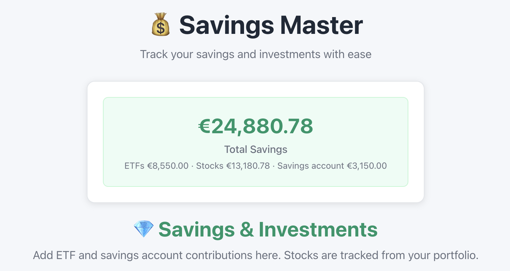

# Savings Master

A personal savings and stock-portfolio tracker that runs on your own machine.
I built it in 2025–2026 with AI coding agents (Cursor Agent, then Claude) to
learn first-hand how to run a team that builds software this way.



## What it does

- Splits monthly savings between ETFs and a savings account, with 20-year
  projections at 5%, 7% and 10% growth.
- Tracks a US stock portfolio: daily closes, dividends, allocation, and a
  dividend-income projection with and without reinvestment.
- Turns every change in share quantity into a savings entry, valued at
  price × USD→EUR rate (European Central Bank rates via Frankfurter).
- Keeps all data in a local SQLite file. The backend only accepts
  connections from this computer.

## Stack

React 19 + TypeScript (Vite) · Node.js 22 + Express 5 · SQLite (better-sqlite3) ·
Chart.js · Eulerpool API (end-of-day prices) · Frankfurter (exchange rates)

## How it was built

I write the intent and acceptance criteria. Agents write the code and the
tests. I review, run it locally and merge. Every change follows the same loop:

1. One branch per change.
2. The agent makes the backend and frontend changes.
3. Tests run against a copy of the database with external APIs stubbed, so
   they never touch real data or the live API quota.
4. TypeScript check.
5. I verify the change by hand.
6. Pull request, review, merge.
7. A database backup before every schema change. Migrations are recorded in
   a `schema_migrations` table and run once.

More detail, including what changed between the two rounds of work:
[docs/how-it-was-built.md](docs/how-it-was-built.md)

## Problems worth a look

- **A retry loop that used up the API quota.** One failing request was
  retried every minute until the day's 25 calls were gone. Now a used-up
  quota or a rejected key stops the whole refresh at once
  ([stockRefresh.js](backend/services/stockRefresh.js),
  [quota test](backend/test/quota.test.js)).
- **Switching data providers.** The first provider's free tier dropped the
  company data the app relied on. All provider calls sit behind one module,
  so the switch to Eulerpool stayed contained. Prices are requested by ISIN
  because some tickers are ambiguous
  ([eulerpoolService.js](backend/services/eulerpoolService.js)).
- **Dividend yield done right.** The trailing 12-month yield lagged a year
  behind dividend raises. The app now uses the forward yield: latest
  dividend × payments per year ÷ latest close
  ([dividend tests](backend/test/dividends.test.js)).
- **Stale prices made visible.** When the provider hasn't published a
  stock's newest close yet, its date is flagged instead of quietly showing
  old data as current ([StockRow.tsx](frontend/src/components/StockRow.tsx)).

## Run it

You need Node.js 22.12 or later, on macOS or Linux.

```bash
git clone https://github.com/jakainul/savings-app.git
cd savings-app
./start.sh --demo
```

The first run installs dependencies, fills `backend/demo.db` with made-up
data and opens the app at http://localhost:3000. No API key is needed.

To use your own data instead, run `./start.sh`. It creates `backend/.env`
from `backend/.env.example`; add a free [Eulerpool](https://eulerpool.com/developers)
key there for live prices. Your data goes to `backend/budget.db`, which git
ignores.

Tests: `cd backend && npm test` · Type check: `cd frontend && npm run typecheck`

## Credits

Data by [Eulerpool](https://eulerpool.com). Exchange rates from the ECB via
[Frankfurter](https://frankfurter.dev). All data in the demo is made up.

MIT License.
